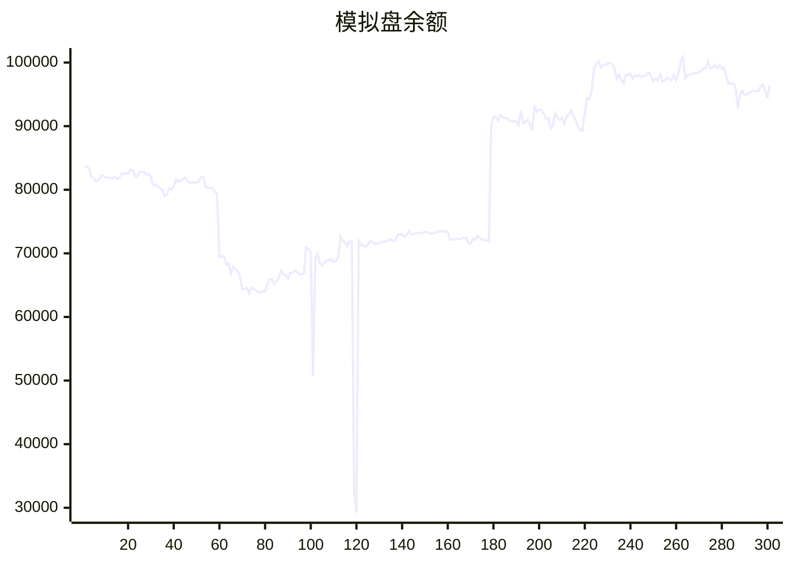

# 📈 AI模拟盘 自动交易报告

本项目利用 Github Action 定时运行 Claude Code，并结合MCP工具，实现在欧易模拟盘环境下自动交易。

## 资产明细
- **BTC**: $65970.0
- **ETH**: $18455.7
- **SOL**: $3617.4
- **USDT**: $8330.0

## 交易记录
- 2026-10-13T06:40:00.000000 - No fills this cycle; HOLD all positions (market analysis flagged HOLD for BTC, ETH and SOL)
- 2026-10-13T06:40:00.000000 - BTC HOLD (conf 60) - ~83.5k, ~1k below 84.5k trim zone; kept resting sells 0.02@84000 (botBtcTp1012) / 0.03@85800 (botBtcTp1011)
- 2026-10-13T06:40:00.000000 - ETH HOLD (conf 55) - ~2528, below 2570-2600 trim zone; kept resting sell 0.5@2585 (botEthTp1012) and buy 0.5@2395 (botEthDip1012)
- 2026-10-13T06:40:00.000000 - SOL HOLD / sell-into-strength (conf 60) - ~108.4, below 110.45 EMA99 trim; kept resting sells 4@111.5 (botSolTrim1012) / 5@116.5 (botSolTp1011)
- 2026-10-13T06:40:00.000000 - No coin trading into its resistance/trim zone; nothing to sell into strength. HOLD all. totalEq ~96,363 USDT; ~5,532 USDT dry powder retained
- 2026-10-12T23:10:00.000000 - Placed 6 resting limit orders: BUY 0.01 BTC-USDT @ 80500 (botBtcDip1012), BUY 0.01 BTC-USDT @ 79500 (botBtcDip1012b), BUY 0.5 ETH-USDT @ 2395 (botEthDip1012), SELL 0.5 ETH-USDT @ 2585 (botEthTp1012), SELL 0.02 BTC-USDT @ 84000 (botBtcTp1012), SELL 4 SOL-USDT @ 111.5 (botSolTrim1012)
- 2026-10-12T23:10:00.000000 - Kept resting take-profits SELL 5 SOL-USDT @ 116.5 (botSolTp1011) and SELL 0.03 BTC-USDT @ 85800 (botBtcTp1011); no cancellations
- 2026-10-12T23:10:00.000000 - Noted prior-cycle fills: BUY 0.5 ETH-USDT @ 2460 + 0.4 ETH-USDT @ 2510 (dip-ladder adds), BUY 0.04 BTC-USDT @ 81900/82700/83000, BUY 8.5 SOL-USDT @ 108, SELL 0.5 ETH-USDT @ 2585 (TP)
- 2026-10-12T23:10:00.000000 - Defensive de-levered tape (OKX loan ratios ~2.6-4.2, spot-ETF outflows); BTC HOLD (RS 58), ETH HOLD/accumulate (62, daily RSI ~30), SOL trim 4@111.5 (70, weakest - lost 99-EMA 111.15); ~5532 USDT dry powder retained
- 2026-10-12T23:10:00.000000 - No fills this cycle; account ~91% invested, totalEq ~94422 USDT
- 2026-10-12T05:34:57.000000 - Place limit BUY 0.01 BTC @ 83000 (order 4002407848793878529, top-up strongest-RS BTC dip ladder to ~3% size)
- 2026-10-12T05:34:57.000000 - Place limit BUY 0.40 ETH @ 2485 (order 4002407853558607873, build underweight ETH on dip within 2480-2520 entry zone)
- 2026-10-12T05:34:57.000000 - KEEP 9 resting orders - BTC dip ladder 83000/82700/81900, ETH dip ladder 2510/2485/2460; TP sells BTC 0.03@85800, ETH 0.5@2585, SOL 5@116.5
- 2026-10-12T05:34:57.000000 - HOLD BTC/ETH/SOL core - no SOL adds (weakest RS); no cancellations; no fills this cycle
- 2026-10-11T18:47:45.000000 - Place limit BUY 0.4 ETH @ 2510 (order 4001107803599548417, scale-in dip-buy; deepest-oversold major)
- 2026-10-11T18:47:45.000000 - Keep resting BUY 0.6 ETH @ 2460 (order 4000353679685726209, pre-existing dip-buy)
- 2026-10-11T18:47:45.000000 - HOLD BTC/ETH/SOL core - no SOL adds (weakest RS, below 20-SMA ~116.9, negative daily MACD); no cancellations
- 2026-10-11T12:40:00.000000 - Place limit BUY 0.02 BTC @ 81900 (order 4000353673612374017, resting dip-buy)
- 2026-10-11T12:40:00.000000 - Place limit BUY 0.6 ETH @ 2460 (order 4000353679685726209, resting dip-buy)
- 2026-10-11T12:40:00.000000 - Place limit SELL 4.38 SOL @ 111.8 on SOL-USDT (order 4000353685859741697, ~15% trim, resting)
- 2026-10-11T12:40:00.000000 - Keep resting TP SELL 0.05 BTC @ 84000 (order 3994603626224431105) and SELL 1.5 ETH @ 2549 (order 3994603619949752321)
- 2026-10-11T12:40:00.000000 - HOLD BTC/ETH/SOL core - no new SOL adds (weakest, below EMA99, negative daily MACD); no cancellations
- 2026-10-11T05:23:48.000000 - Sell 16.24 SOL @ avg 109.72 on SOL-USDT (market), received ~1781.9 USDT, fee 1.78 USDT [order 3999481216605106177]
- 2026-10-11T05:23:48.000000 - HOLD BTC (neutral, range 82200-83700, conf 55); HOLD ETH (neutral, conf 55)
- 2026-10-10T23:26:00.000000 - Cancelled 4 stale resting dip-buys (BTC 0.007@81900, SOL 3@106, ETH 0.24@2465, ETH 0.26@2465); freed ~2123.8 USDT
- 2026-10-10T23:26:00.000000 - Placed limit BUY 0.20 ETH-USDT @ 2500 (order 3998768379305930753, ~500 USDT, ~10% of avail USDT, resting unfilled)
- 2026-10-10T23:26:00.000000 - Kept reduce-only take-profit sells: BTC 0.05@84000, ETH 1.5@2549; no adds to BTC/SOL; flat/no shorts
- 2026-10-10T18:30:00.000000 - HOLD - no new orders this cycle; kept 6 resting limits (BTC buy 0.007@81900, BTC sell 0.05@84000, ETH buy 0.5@2465, ETH sell 1.5@2549, SOL buy 3@106); account ~95% invested, ~2815 USDT dry powder
- 2026-10-10T12:25:12.000000 - Place limit BUY 0.26 ETH @ $2,465 (order 3997422013258412033, resting ETH dip-buy; combined pending ETH dip-buy now 0.5 ETH; BTC/SOL HOLD, no fills)
- 2026-10-10T00:00:38.000000 - Place limit BUY 0.007 BTC @ $81,900 (order 3995931476030402561, resting unfilled dip-buy)
- 2026-10-10T00:00:38.000000 - Place limit BUY 0.24 ETH @ $2,465 (order 3995931480493142017, resting unfilled dip-buy)
- 2026-10-10T00:00:38.000000 - Place limit BUY 3 SOL @ $106.0 (order 3995931484855218177, resting unfilled dip-buy)
- 2026-10-09T19:26:10.987713 - Sell 24 SOL @ avg $109.29 on SOL-USDT (market), received ~2622.96 USDT
- 2026-10-09T13:01:19.838220 - Sell limit 0.05 BTC @ 84000 USDT (resting, unfilled)
- 2026-10-09T13:01:19.838216 - Sell limit 1.5 ETH @ 2549 USDT (resting, unfilled)
- 2026-10-09T05:45:04.031332 - Buy 13.5 SOL @ 110.58, spent ~1492.83 USDT
- 2026-10-08T17:21:48.979950 - Place limit SELL 1.5 ETH @ $2,600.0 (order 3992228753720225793)
- 2026-10-08T17:21:48.979947 - Place limit SELL 25 SOL @ $114.0 (order 3992228749190377473)
- 2026-10-08T00:19:49.237529 - Buy 0.0239853 BTC @ avg 83384.4, spent 2000 USDT (BTC-USDT market)
- 2026-10-08T00:19:49.237526 - Buy 1.164435 ETH @ avg 2576.36, spent 3000 USDT (ETH-USDT market)
- 2026-10-07T13:15:12.299690 - Buy 1.171531 ETH, spent 3000 USDT (avg 2560.75)

## MCP工具
- [mcp-aktools](https://github.com/aahl/mcp-aktools): 用于查询价格走势及行情
- [mcp-okx](https://github.com/aahl/mcp-okx): 用于获取欧易账户信息和下单
- [mcp-notify](https://github.com/aahl/mcp-notify): 用于推送分析结果到指定渠道(可选)
- [mcp-hooks](https://github.com/aahl/ai-trading/tree/main/mcp-hooks.py): 用于保存交易结果和更新Readme

## 相关链接
- https://t.me/s/mcpBtc
- [自动交易工作流配置文件](https://github.com/aahl/ai-trading/blob/main/.github/workflows/claude.yaml)
- [自动交易工作流运行记录](https://github.com/aahl/ai-trading/actions/workflows/claude.yaml)
- [智谱免费模型可用于 Claude Code](https://www.bigmodel.cn/invite?icode=EwilDKx13%2FhyODIyL%2BKabHHEaazDlIZGj9HxftzTbt4%3D)
- [GLM Coding Plan·限时优惠](https://www.bigmodel.cn/claude-code?ic=WTOWFVEJXH)
- [欧易模拟盘API接口申请](https://www.okx.com/zh-hans/help/how-can-i-do-spot-trading-with-the-jupyter-notebook)
