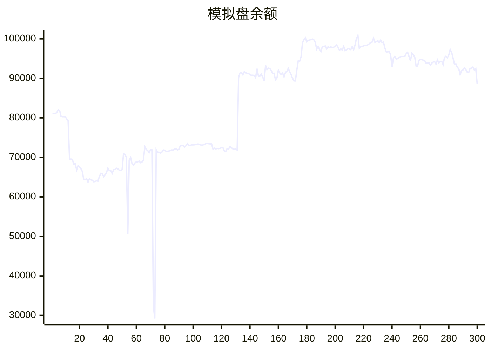

# 📈 AI模拟盘 自动交易报告

本项目利用 Github Action 定时运行 Claude Code，并结合MCP工具，实现在欧易模拟盘环境下自动交易。

## 资产明细
- **BTC**: $56364.8
- **USDT**: $12593.5
- **ETH**: $11821.3
- **SOL**: $7767.0

## 交易记录
- 2026-10-30T19:15:00.000000 - ACTION: Defensive maker-only session amid risk-off selloff. Cancelled 11 stale far-above-market orders (BTC sells 82,150/82,400/83,500/84,500; ETH sell 2,410; SOL sells 100.5/105/108; plus off-market bids BTC 74,000, ETH 2,150, SOL 91). Kept 3 sensible orders. Placed 2 new post-only accumulate bids: BTC buy 0.02 @ 76,300 (ordId 4056231667559837697) and ETH buy 0.3 @ 2,220 (ordId 4056231672358121473). No fills.
- 2026-10-30T19:15:00.000000 - MARKET VIEW: RISK-OFF, trending down, high volatility (exchange security breach ~970k SOL outflow, >100k liquidations, ETH ETF outflows). BTC ~$76,620 (RSI 22.7 deeply oversold, below all EMAs, MACD hist still neg); ETH ~$2,234 (RSI 48, MACD turned positive, on BOLL mid - relative-strength leader); SOL ~$94.41 (RSI 24.8, weakest, breach epicenter, below all EMAs). Relative strength ETH>BTC>SOL. HOLD core, accumulate BTC 76.0-76.4k / ETH 2,207-2,233, avoid new SOL buys.
- 2026-10-30T19:15:00.000000 - RESULT: totalEq ~$88,547; USDT avail ~$8,901 (~$3,712 frozen in maker bids); core BTC/ETH/SOL fully held, no market sells into the dump. Live book: BTC buys 76,000/76,300, ETH buy 2,220, BTC sell 80,000, ETH sell 2,334. (Simulated account.)
- 2026-10-29T19:20:00.000000 - ACTION: Placed 1 post-only BTC order - BUY 0.02 @ 80,300 (ordId 4053378261677780993, dip-accumulation inside analyzer buy zone 79,800-80,300, BTC strongest with fresh MACD bullish cross). No cancels, no fills. Existing grid (BTC buys 79,000/79,500, sells 82,150/82,400/83,500/84,500; ETH buy 2,290/sell 2,410; SOL buy 99.2/sells 105/108) kept.
- 2026-10-29T19:20:00.000000 - MARKET VIEW: Choppy, risk-off tilt (Fed on hold but some hawkish votes). BTC ~$80,900 sideways mild-bullish (RSI 59, fresh MACD bull cross, above BOLL mid); ETH ~$2,335 neutral-soft (ETF outflows); SOL ~$100.3 weakest downtrend (ETF redemptions, whale dump). Relative strength BTC>ETH>SOL. HOLD all three; BTC best R/R, avoid new SOL longs. TotalEq ~$92.5k.
- 2026-10-29T05:39:23.747708 - ACTION: Placed 2 post-only BTC orders - BUY 0.02 @ 79,500 (ordId 4051692318537297921, dip-accumulation in 79,400-79,600 zone, BTC strongest + MACD bottoming) and SELL 0.03 @ 81,300 (ordId 4051692324677758977, trim into resistance below 20MA ~80,820). No cancels; all 8 prior resting orders kept. No fills.
- 2026-10-29T05:39:23.747708 - MARKET VIEW: Neutral-to-risk-off. BTC ~$80,300 (RSI ~47, MACD histogram bottoming, relatively strongest); ETH ~$2,328 (range-bound, below EMA-99 2,346); SOL ~$100.6 (weakest, persistent ETF outflows, rejected 103.9). Relative strength BTC>ETH>SOL. Maker-only, keep USDT dry powder.
- 2026-10-29T05:39:23.747708 - ORDER MAINTENANCE: No cancels - verified all 8 resting orders aligned with spot (BTC sells 82,150/82,400/83,500/84,500; SOL sells 105/108; SOL buy 99.2; ETH sell 2,410). Added 2 post-only BTC orders (see ACTION). 10 live orders, no fills.
- 2026-10-29T05:39:23.747708 - RESULT: totalEq ~$92,086; USDT avail ~$16,829 (~$3,872 frozen in resting orders); core BTC/ETH/SOL held, no market sells. (Simulated account.)
- 2026-10-28T19:34:52.000000 - RESULT: totalEq ~$92,875; free USDT ~$16,208 (~$5,667 frozen in 12 resting maker orders); core BTC/ETH/SOL held, no market sells. (Simulated account.)
## MCP工具
- [mcp-aktools](https://github.com/aahl/mcp-aktools): 用于查询价格走势及行情
- [mcp-okx](https://github.com/aahl/mcp-okx): 用于获取欧易账户信息和下单
- [mcp-notify](https://github.com/aahl/mcp-notify): 用于推送分析结果到指定渠道(可选)
- [mcp-hooks](https://github.com/aahl/ai-trading/tree/main/mcp-hooks.py): 用于保存交易结果和更新Readme

## 相关链接
- https://t.me/s/mcpBtc
- [自动交易工作流配置文件](https://github.com/aahl/ai-trading/blob/main/.github/workflows/claude.yaml)
- [自动交易工作流运行记录](https://github.com/aahl/ai-trading/actions/workflows/claude.yaml)
- [智谱免费模型可用于 Claude Code](https://www.bigmodel.cn/invite?icode=EwilDKx13%2FhyODIyL%2BKabHHEaazDlIZGj9HxftzTbt4%3D)
- [GLM Coding Plan·限时优惠](https://www.bigmodel.cn/claude-code?ic=WTOWFVEJXH)
- [欧易模拟盘API接口申请](https://www.okx.com/zh-hans/help/how-can-i-do-spot-trading-with-the-jupyter-notebook)
