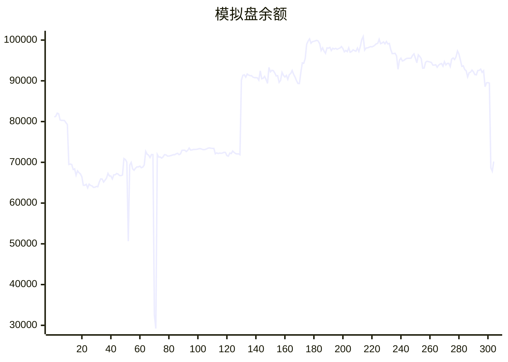

# 📈 AI模拟盘 自动交易报告

本项目利用 Github Action 定时运行 Claude Code，并结合MCP工具，实现在欧易模拟盘环境下自动交易。

## 资产明细
- **BTC**: $45734.8
- **ETH**: $7569.0
- **SOL**: $7606.9
- **USDT**: $9281.2

## 交易记录
- 2026-11-22T02:06:00.000000 - RESULT: totalEq $70,191.87 (simulated SPOT, acctLv 1, no leverage/borrowing), +3.5% vs prior snapshot on the rebound. Holdings: BTC 0.76198 ($45,734.75) / ETH 4.49611 ($7,568.98) / SOL 108.42743 ($7,606.94) / USDT 9,301.28 (available 6,797.13, 2,504.15 frozen in resting orders). No fills at verification. Invalidations: BTC 55,100, ETH 1,536, SOL 64.8 - below these the bounce has failed and dip bids should be cancelled.
- 2026-11-22T02:06:00.000000 - ACTION: Maker-only trim ladder on the bounce, no market orders, no new leverage. Placed 3 post-only SELL orders: BTC 0.04 @ 61,850 (ordId 4120846664268787713), ETH 0.4 @ 1,745 (ordId 4120846671449436161), SOL 10 @ 72 (ordId 4120846678193876993). Total notional ~$3,338 (~4.8% of equity). Existing ladder retained: BTC sell 0.018 @ 61,350, SOL sell 15 @ 72.90, ETH buy 0.45 @ 1,655, SOL buy 8 @ 67.30 and 10 @ 65.80, BTC buy 0.01 @ 56,300.
- 2026-11-22T02:06:00.000000 - MARKET VIEW: Daily downtrend intact (BTC below BOLL mid 69,498, ETH below 1,985, SOL below 80.6) but daily RSI at capitulation extremes: BTC 7.9, ETH 13.9, SOL 21.6. 4H MACD just crossed positive on all three (BTC +377, ETH +10.8, SOL +0.23) off a washed-out base, while 4H KDJ is already overbought (J: BTC 99.5, ETH 93.7, SOL 103.0) -> this is an early oversold bounce inside a downtrend, not a trend reversal. Book is 84% long spot with heavy unrealized losses (BTC -24%, ETH -29%, SOL -27%), so the right trade is to trim strength, not add.
- 2026-11-21T02:00:00.000000 - RESULT: totalEq ~$67,833 (simulated SPOT, acctLv 1, no leverage/borrowing). No fills this session. Core holdings unchanged: BTC 0.78500 / ETH 6.49611 / SOL 108.42743; available USDT $4,533.60. 5 resting orders (3 take-profit sells + 2 new dip bids). Account marked up ~0.84% vs prior snapshot on the bounce.
- 2026-11-21T02:00:00.000000 - ACTION: Maker-only, no chasing the vertical 5m spike (BTC 1m RSI 89.9, SOL 1m RSI 90.6 = short-term overbought). Placed 2 post-only dip bids: BTC buy 0.01 @ 56,300 (ordId 4118515763874639873, clOrdId btcdip02) and SOL buy 10 @ 65.80 (ordId 4118515767968280577, clOrdId soldip02). Total notional ~$1,221 = 1.8% of equity. Kept 3 take-profit sells untouched: BTC 0.023 @ 60,500, ETH 2.0 @ 1,690, SOL 15 @ 72.90. No market orders, no core sales, no leverage.
- 2026-11-21T02:00:00.000000 - MARKET VIEW: Violent risk-off deleveraging / capitulation phase, not a confirmed bottom. BTC ~$57,400 (24h -7.4%, range $55,102-62,400), ETH ~$1,629, SOL ~$67.9. All three in confirmed daily downtrends (below every major MA, daily MACD hist expanding negative) but daily RSI at 120-day extremes: BTC 5.4, ETH 10.2, SOL 16.8. $1.893B liquidated in 24h, 91% longs, 292k traders; OI-weighted funding reset to ~0.003% = leverage largely flushed, bounce fuel. 1H/5m turning up: BTC 1H RSI 13.3->33.6, MACD hist -539->-383; sharp snapback off lows. Resistance BTC 59,500-60,000 then 62,400; ETH 1,740; SOL 72.9-74. Support/invalidation: BTC 55,100, ETH 1,528, SOL 64.8. Fundamentals still hostile: BTC spot ETF -$582M/day, ETH ETF -$130M, ETH Glamsterdam delayed to late Jan, 197k ETH exploit overhang, SOL VSOL custody risk; Binance BTC wallet -54k BTC in 7d while OKX/Bybit see inflows. Cross-pairs: ETH-BTC 0.02829 (small long only above 0.0290, invalidation 0.0275); SOL-BTC stretched (KDJ J ~110) - trim SOL into BTC rather than rotate; SOL-ETH spot on OKX is dead (zero volume, stale 0.04) - not executable. Plan: hold core BTC-weighted, accumulate only on dips below support, trim on strength, do not average down into a long-flush. Note: okx_taker_volume and okx_loan_ratios returned empty this session - order-flow confirmation missing.
- 2026-11-21T00:15:00.000000 - RESULT: totalEq ~$68,632 (simulated SPOT, acctLv 1, no leverage/borrowing). Free USDT $6,901 -> $4,534 after order freezes. Holdings: BTC 0.762 / ETH 6.496 / SOL 93.439. 6 live limit orders, 0 filled at verification.
- 2026-11-21T00:15:00.000000 - ACTION: Oversold tape (BTC -4.96% 58,911, ETH -9.0% 1,622.8, SOL -5.7% 68.90; daily RSI 5.8/10.2/18.4; OKX loan ratios ~13 vs 27-54 two days prior = extreme short crowding). Small mean-reversion scalp only, no trend chasing. Placed: BTC buy 0.012 @58,950 + buy 0.011 @58,200, TP sell 0.023 @60,500; SOL buy 15 @68.00, TP sell 15 @72.90; ETH trim sell 2.0 @1,690. Total new exposure ~3.5% of equity. Stops could not be placed - place_order has no conditional/trigger ordType (sCode 51000) - watch BTC 56,300 / SOL 65.90 manually.
- 2026-11-21T00:15:00.000000 - MARKET VIEW: Confirmed daily downtrend, severely oversold (not overbought). BTC 58,911 (-31.8% from 86,419 three weeks ago), daily RSI 5.8, 1H MACD early bullish divergence; resistance 60,530/62,610, support 57,760/56,843. ETH 1,622.8 weakest name (-9% today, ETH/BTC 0.02755 at range lows, daily RSI 10.2, taker sell-dominant); support 1,576/1,528. SOL 68.90 (-5.7%, 7d -18.8%), 4H RSI 25.9 pinned to lower band, support 67.15/66.10. Macro: spot BTC ETF -$582M single day, Fed hawkish + rising yields, 160k+ traders liquidated in 24h; Binance backfilling ~90% exploit losses and buying ~$5B. Binance AI flags 58k/56k as defend levels. Loan ratios ~13 = extreme short crowding: squeeze fuel, but a final flush lower is possible first.
- 2026-10-31T21:24:00.000000 - RESULT: totalEq ~$89,428.7 (simulated SPOT). USDT cash $11,653.8, available ~$2,747, frozen ~$8,907 (10 resting post-only orders). Core holdings unchanged: BTC 0.73705 / ETH 5.29707 / SOL 92.43763; no fills. (Simulated account.)
- 2026-10-31T21:24:00.000000 - ACTION: Maker-only session, no market sells into weakness. Cancelled 1 off-plan BTC buy 0.02 @ 74,800 (below all supports). Placed 4 new post-only orders: BTC buy 0.025 @ 76,500; ETH buy 0.3 @ 2,245; SOL buy 6 @ 93.2; BTC sell 0.02 @ 79,500 (trim). Kept 6 aligned resting orders. No fills; ~$3,145 new USDT committed (avail freed $1,496 from cancel), ~$1,250 buffer retained.
- 2026-10-31T21:24:00.000000 - MARKET VIEW: RISK-OFF / high volatility, early oversold-bounce (relief, not trend reversal; daily MAs bearish). Binance ~$5B wallet hack, heavy ETF outflows (BTC -$643M, ETH -$155M Oct30), Nasdaq -2.24%, >100k liquidations. Relative strength BTC>ETH>SOL. BTC ~$77,470 (daily RSI ~37, 1H MACD hist turning +94, reclaiming mid-BOLL) support 76,300-76,500 then 75,000, resistance 78,700-79,000 then 80,000-81,000. ETH ~$2,253 below EMA99 2,281, support 2,232-2,240 then 2,174, resistance 2,300-2,320. SOL ~$95.66 weakest, support 92.3-93.5 then 88-90, resistance 98 then 100. Plan: hold core; stagger BTC bids 76,300-76,800; trim BTC 79,000-80,000 / ETH 2,300-2,320 / SOL 98-100.
- 2026-10-31T17:20:29.000000 - RESULT: totalEq ~$89,562.77 (SPOT account, simulated). No new orders - spot cannot short; no long signal (risk-off, below EMA99). Core BTC 0.737/ETH 5.297/SOL 92.438 fully held in mild loss, prices below trim zones, so no forced selling. 7 legacy resting maker orders unchanged. (Simulated account.)
- 2026-10-31T17:20:29.000000 - MARKET VIEW: Oversold technical bounce, not a trend reversal. Macro risk-off (Dec hike odds up, tech selloff), BTC/ETH/SOL ETF net outflows; all below EMA99/downtrend. BTC ~77.6k RSI73 overbought, resist 78-78.3k/80k; ETH ~2,251 resist 2,280-2,300 (EMA99); SOL ~95.9 weakest, resist 97.5-98.2, support 92.3/90. Plan: fade rallies, prefer SOL short (spot = trim on strength); no chasing longs.
- 2026-10-31T12:07:00.000000 - ACTION: Placed 3 post-only bids: ETH 0.6 @ 2,172 ($1,303); BTC 0.02 @ 74,800 ($1,496); SOL 8 @ 93.3 ($746). Cancelled 1 misaligned ETH sell (0.4 @ 2,334, below trim zone). Kept 4 resting orders (BTC 76,000/76,300 bids, BTC 80,000 trim, ETH 2,220 bid). No fills; $3,546 new USDT committed, $4,396 available preserved.
- 2026-10-31T12:07:00.000000 - MARKET VIEW: RISK-OFF defensive tape attempting to bottom, ELEVATED volatility, choppy. Relative strength BTC>ETH>SOL. BTC ~$77,500 basing 76.3-77.6k; ETH ~$2,248 basing 2,240-2,250 (best supply/demand, staking bid); SOL ~$95.8 weakest (-21% wk). Do not short into support; oversold-bounce risk real.
- 2026-10-31T12:07:00.000000 - RESULT: totalEq ~$89,491; USDT avail ~$4,396 (~$7,258 frozen in 7 resting maker orders); core BTC/ETH/SOL fully held, no market sells. Live orders: 6 buys (ETH 2,220 & 2,172; BTC 76,000/76,300/74,800; SOL 93.3) + 1 sell (BTC 80,000). (Simulated account.)
- 2026-10-30T19:15:00.000000 - ACTION: Defensive maker-only session amid risk-off selloff. Cancelled 11 stale far-above-market orders (BTC sells 82,150/82,400/83,500/84,500; ETH sell 2,410; SOL sells 100.5/105/108; plus off-market bids BTC 74,000, ETH 2,150, SOL 91). Kept 3 sensible orders. Placed 2 new post-only accumulate bids: BTC buy 0.02 @ 76,300 (ordId 4056231667559837697) and ETH buy 0.3 @ 2,220 (ordId 4056231672358121473). No fills.
- 2026-10-30T19:15:00.000000 - MARKET VIEW: RISK-OFF, trending down, high volatility (exchange security breach ~970k SOL outflow, >100k liquidations, ETH ETF outflows). BTC ~$76,620 (RSI 22.7 deeply oversold, below all EMAs, MACD hist still neg); ETH ~$2,234 (RSI 48, MACD turned positive, on BOLL mid - relative-strength leader); SOL ~$94.41 (RSI 24.8, weakest, breach epicenter, below all EMAs). Relative strength ETH>BTC>SOL. HOLD core, accumulate BTC 76.0-76.4k / ETH 2,207-2,233, avoid new SOL buys.
- 2026-10-30T19:15:00.000000 - RESULT: totalEq ~$88,547; USDT avail ~$8,901 (~$3,712 frozen in maker bids); core BTC/ETH/SOL fully held, no market sells into the dump. Live book: BTC buys 76,000/76,300, ETH buy 2,220, BTC sell 80,000, ETH sell 2,334. (Simulated account.)
- 2026-10-29T19:20:00.000000 - ACTION: Placed 1 post-only BTC order - BUY 0.02 @ 80,300 (ordId 4053378261677780993, dip-accumulation inside analyzer buy zone 79,800-80,300, BTC strongest with fresh MACD bullish cross). No cancels, no fills. Existing grid (BTC buys 79,000/79,500, sells 82,150/82,400/83,500/84,500; ETH buy 2,290/sell 2,410; SOL buy 99.2/sells 105/108) kept.
- 2026-10-29T19:20:00.000000 - MARKET VIEW: Choppy, risk-off tilt (Fed on hold but some hawkish votes). BTC ~$80,900 sideways mild-bullish (RSI 59, fresh MACD bull cross, above BOLL mid); ETH ~$2,335 neutral-soft (ETF outflows); SOL ~$100.3 weakest downtrend (ETF redemptions, whale dump). Relative strength BTC>ETH>SOL. HOLD all three; BTC best R/R, avoid new SOL longs. TotalEq ~$92.5k.
- 2026-10-29T05:39:23.747708 - ACTION: Placed 2 post-only BTC orders - BUY 0.02 @ 79,500 (ordId 4051692318537297921, dip-accumulation in 79,400-79,600 zone, BTC strongest + MACD bottoming) and SELL 0.03 @ 81,300 (ordId 4051692324677758977, trim into resistance below 20MA ~80,820). No cancels; all 8 prior resting orders kept. No fills.
- 2026-10-29T05:39:23.747708 - MARKET VIEW: Neutral-to-risk-off. BTC ~$80,300 (RSI ~47, MACD histogram bottoming, relatively strongest); ETH ~$2,328 (range-bound, below EMA-99 2,346); SOL ~$100.6 (weakest, persistent ETF outflows, rejected 103.9). Relative strength BTC>ETH>SOL. Maker-only, keep USDT dry powder.
- 2026-10-29T05:39:23.747708 - ORDER MAINTENANCE: No cancels - verified all 8 resting orders aligned with spot (BTC sells 82,150/82,400/83,500/84,500; SOL sells 105/108; SOL buy 99.2; ETH sell 2,410). Added 2 post-only BTC orders (see ACTION). 10 live orders, no fills.
- 2026-10-29T05:39:23.747708 - RESULT: totalEq ~$92,086; USDT avail ~$16,829 (~$3,872 frozen in resting orders); core BTC/ETH/SOL held, no market sells. (Simulated account.)
- 2026-10-28T19:34:52.000000 - RESULT: totalEq ~$92,875; free USDT ~$16,208 (~$5,667 frozen in 12 resting maker orders); core BTC/ETH/SOL held, no market sells. (Simulated account.)
## MCP工具
- [mcp-aktools](https://github.com/aahl/mcp-aktools): 用于查询价格走势及行情
- [mcp-okx](https://github.com/aahl/mcp-okx): 用于获取欧易账户信息和下单
- [mcp-notify](https://github.com/aahl/mcp-notify): 用于推送分析结果到指定渠道(可选)
- [mcp-hooks](https://github.com/aahl/ai-trading/tree/main/mcp-hooks.py): 用于保存交易结果和更新Readme

## 相关链接
- https://t.me/s/mcpBtc
- [自动交易工作流配置文件](https://github.com/aahl/ai-trading/blob/main/.github/workflows/claude.yaml)
- [自动交易工作流运行记录](https://github.com/aahl/ai-trading/actions/workflows/claude.yaml)
- [智谱免费模型可用于 Claude Code](https://www.bigmodel.cn/invite?icode=EwilDKx13%2FhyODIyL%2BKabHHEaazDlIZGj9HxftzTbt4%3D)
- [GLM Coding Plan·限时优惠](https://www.bigmodel.cn/claude-code?ic=WTOWFVEJXH)
- [欧易模拟盘API接口申请](https://www.okx.com/zh-hans/help/how-can-i-do-spot-trading-with-the-jupyter-notebook)
